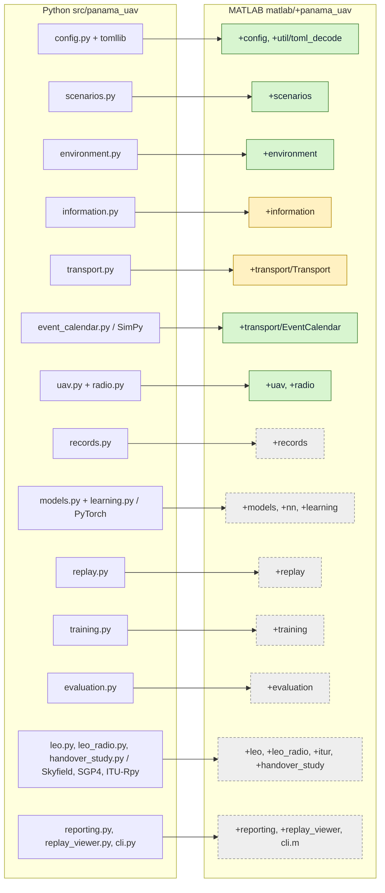

# MATLAB port (starter)

The `matlab-port-v2` branch carries a MATLAB port of the UAV–PANAMA communication staleness
study. It is a **starter**: the core simulation is ported and checked against
the Python code, and every other module is a stub with the right signature.
The plan, tolerances and handoff checklist are in
[matlab/PORT_PLAN.md](matlab/PORT_PLAN.md).

- Plain MATLAB with no toolboxes. It targets R2021b or later.
- So far it has only been verified on **GNU Octave 9.4.0** (there is no MATLAB license yet).
- Code lives in [`matlab/`](matlab), package `+panama_uav`, with one
  sub-package per Python module.
- The port adds only `matlab/` and this file. Python code,
  configs, maps and the rest of the repository are used as they are on `main`.

## Module map



Green means ported and parity-tested, yellow means partly ported, and grey
means a stub that raises `panama_uav:notImplemented`.

## Status

| Python module | MATLAB | Status | Parity test (tolerance) |
| --- | --- | --- | --- |
| `config.py` (+ `tomllib`) | `+config`, `+util/toml_decode.m` | **parity-tested** | `TomlTest`: all 4 configs (base, fast_pilot, leo_learning, leo_tremblant) decode identically, with int/float type preserved (exact), and 93 small texts recorded from tomllib (number grammar, duplicate keys and tables including dotted keys in inline tables, line endings, int64 bounds, UTF-8 text, end of input) are accepted with the same value or rejected at tomllib's line, plus 37 texts recorded as bytes (control characters in strings, keys and comments, bare CR, invalid UTF-8) that must match tomllib's value, line, or Python's exact UTF-8 decode error; `read_text` rejects invalid UTF-8 (`panama_uav:utf8`) as Python does; `matlab/tools/toml_corpus.py` adds a random-document comparison. `ConfigTest`: the 4 configs and the smoke profile match `to_dict()`, and 24 synthetic TOML texts, at least one per study rule, are accepted or rejected exactly as Python's `load_config` does (same `ValueError` message). `matlab/tools/mutation_sweep.py` measures this: it disables each of the 20 config rules in turn and reports whether an assertion catches it |
| `scenarios.py` | `+scenarios` | **parity-tested** | `MapsTest`: all 13 maps, 3 scenario files (exact) |
| `environment.py` | `+environment` | **parity-tested** (`prepare_decision` is a stub, M4) | `MapsTest`: 62 A* paths plus 7 hand-made up/down and left/right tie cases (exact). `EnvironmentParityTest`: 10 rollouts, 2–8 agents, including one truncated at a 12-step cap; reset info and reset observations are checked too. `Golden01Test`: the frozen 0.1 trace on 3 routes. Positions, collisions, termination, truncation and observations are exact; rewards abs 1e-12; UAV abs 1e-12 m. `RngTest`: seedless and seeded episode generation, Marsaglia's published xor128 outputs, and the odd-agent free-cell guard (off by one in Python, inherited on purpose; see PORT_PLAN §8) |
| `information.py` | `+information` | **parity-tested** (except `prepare_decision`, M4) | Per-step information ages, report ages and cached guidance, abs 1e-12 s; `InformationTest` |
| `transport.py` | `+transport/` (`Transport`, `DelayTrace`, `encode_size`) | **partial**: `perfect`, `controlled` and `physical` (without orbital timelines, M5) are parity-tested; mission-payload wire sizes and `import_trace` are M1b-2 | `EnvironmentParityTest`: transport log (reservations, exposures, buffering, deliveries), abs 1e-12 s, message counters exact. `TransportTest`: 29 physical-profile replays (round robin, fragmentation and overhead, handover pauses, propagation, uplink/downlink delay traces with time offset, contention, occupancy, handover windows, Python's error messages; 16 of them seeded random) compare every log entry, counter, delivery and occupancy, with all times bit-exact, plus 306 direct `finish_transmission` cases. `EncodeTest`: 331 pickle sizes, exact. `TraceTest`: the `.npz` arrays and metadata written by Python's `import_trace`, and 140 `DelayTrace.delay` queries, bit-exact |
| `event_calendar.py` (SimPy) | `+transport/EventCalendar.m` | **parity-tested** | `CalendarTest`: 60-op replay with ties and float offsets; times bit-exact |
| `uav.py`, `radio.py` | `+uav`, `+radio` | **parity-tested** | `UavTest`: model constants rel 1e-12, 25-step trajectory and tracking error abs 1e-12 m, float32 SNR maps exact at single precision (per step at 5 cells and the sum, and the full map at the end) |
| `records.py` | `+records` | stub (M3) | — |
| `models.py`, `learning.py` | `+models`, `+nn`, `+learning` | stub (M2/M3) | — |
| `replay.py` | `+replay` | stub (M3) | — |
| `training.py` | `+training` | stub (M3) | — |
| `evaluation.py` | `+evaluation` | stub (M4) | — |
| `leo.py`, `leo_radio.py`, `handover_study.py` | `+leo`, `+leo_radio`, `+itur`, `+handover_study` | stub (M5) | — |
| `reporting.py`, `replay_viewer.py`, `cli.py` | `+reporting`, `+replay_viewer`, `cli.m` | stub (M6) | — |

`ScaffoldTest` checks that exactly 57 stub files exist and that each raises
`panama_uav:notImplemented`. Unported methods on ported classes
(`ExperimentEnvironment.prepare_decision`, `MissionCommunication.prepare_decision`,
an orbital `leo_timeline` with the physical profile, and `encode_size` on a
mission payload, so a physical-profile mission run) raise the same error.

**Random draws.** NumPy's random streams are not reproduced. The parity
tests inject the NumPy draws (starts and goals, and reservation windows)
through `reset('starts', S, 'goals', G, 'windows', W)`.

Without injected draws, the environment follows Python's semantics with a
portable generator, `panama_uav.util.Xorshift128`:
- `reset()` advances the environment's generator, so every episode differs.
- `reset('seed', s)` reseeds it.
- Reservation windows come from the base or explicit seed.

The same seed gives the same episodes on MATLAB and Octave, but not the
episodes NumPy draws for that seed. Those runs match Python only in
distribution. See [PORT_PLAN §5](matlab/PORT_PLAN.md).

## Run the tests

MATLAB R2021b or later, from the repository root:

```matlab
cd matlab
ok = run_tests()          % matlab.unittest suite in matlab/tests
ok = run_tests('Env')     % only test files whose name contains 'Env'
```

GNU Octave 9.x (Ubuntu: `sudo apt-get install -y octave unzip`, with no extra Octave packages; `unzip` reads the `.npz` delay traces):

```bash
cd matlab
octave-cli --no-gui --eval "ok = run_tests(); exit(~ok)"
```

The full suite (58 tests) takes about 2.5 minutes on Octave. On Octave, `run_tests`
adds `matlab/compat/octave`, which provides a small `matlab.unittest.TestCase`
shim. Like `matlab.unittest`, the shim's `verifyEqual` is class-strict:
`int64(1)` vs `1` and `single` vs `double` both fail. MATLAB never loads it.

**CI (Octave).** An `ubuntu-latest` job only needs
`sudo apt-get install -y octave-cli unzip` followed by the `octave-cli` command
above; a non-zero exit fails the job. No workflow file is committed yet.

## Regenerate the golden fixtures

The fixtures in `matlab/tests/fixtures/` are generated from the Python code.
They are not copied from any recorded results.

```bash
python -m pip install numpy simpy        # torch is not needed for M1 fixtures
python matlab/tools/make_fixtures.py             # all groups
python matlab/tools/make_fixtures.py env astar   # selected groups
```

To add a group, write a `group_<name>()` function in `make_fixtures.py`.
The `trace` group also writes `trace_uplink.npz` and `trace_downlink.npz`
with Python's `import_trace` (metadata `source` made repository-relative);
every fixture, the `.npz` files included, regenerates byte-identically.

## Figure on demand

Figures are not committed. To draw the map, the robot trajectories and the
task-information age for one stale-information rollout (6 robots, seed 3; the
age reaches 10, which `PlotRolloutTest` checks), run:

```bash
cd matlab
octave-cli --no-gui --eval "addpath(pwd); addpath scripts; plot_rollout()"
# headless Octave: run with `env -u DISPLAY` so the gnuplot toolkit is used
```

In MATLAB, run `addpath scripts; plot_rollout()`. The figure is written to
`matlab/output/rollout.png`, which is gitignored. It uses a scripted
follow-the-cached-route policy, not the trained DQN, so it shows simulator
plumbing and not study results.

## Python ↔ MATLAB conventions

- Positions stay zero-based `[row col]`, as in Python, and the grid is indexed as `grid(r+1, c+1)`.
- Spatial observations are `fov×fov×3` single precision (MATLAB layout), where Python uses `3×fov×fov`.
- Python dicts keyed by agent id become cells or vectors indexed by `id+1`.
- Name-value options reject unknown names, so a typo such as `'start'` errors.
- Python `None` becomes `[]`, a Python tuple of strings becomes a cell row, and a tuple of numbers becomes a row vector.
- For wire sizes (`encode_size`), types must be explicit: a double is a Python float, an integer class (`int64(3)`) an int, a cell row a list, `panama_uav.transport.PyTuple(...)` a tuple, `panama_uav.transport.PyBytes(n)` n bytes, and a scalar struct a str-keyed dict.
- Octave-specific workarounds are commented in the code. `until` is a keyword in Octave. Use `[a, b] = obj.f()` instead of `[a, ~] = obj.f()` inside classdef methods. JSON fixtures that need bit-exact doubles carry hex bits, because Octave's `jsondecode` is not correctly rounded. On Octave, `char` is 8-bit, so non-ASCII text holds its UTF-8 bytes ('é' is 2 chars); use `panama_uav.util.text_length` for Python-style lengths.
