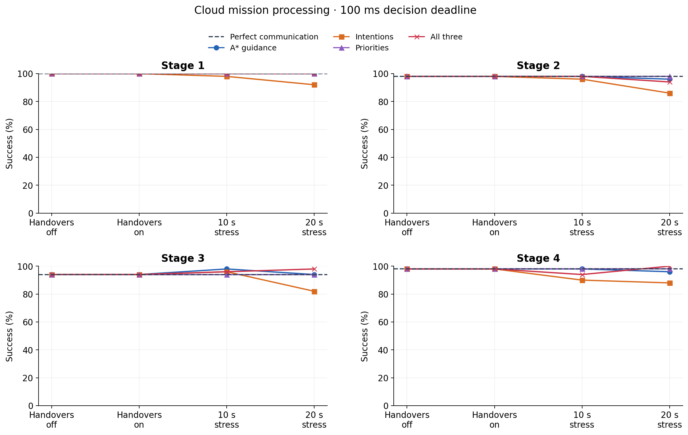
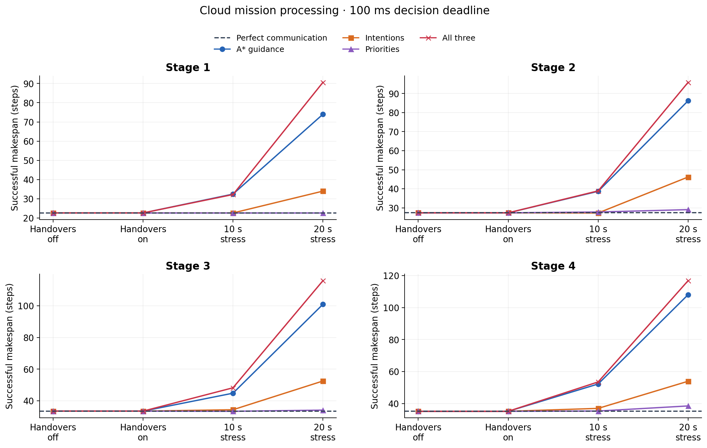

# 100 ms decision deadline and satellite-handover inference

Run `deadline-handover-20261019-01` completed **4,200 measured episode executions**
in 21 conditions, in 10.53 minutes. Each condition
reuses the same 50 held-out cases per stage from the previous inference study.
The qualified Clean final model, starts, goals and seeds remain fixed. Episodes
retain their 250-step cap and simultaneous-goal success criterion. No further
training is performed. The 37 preflight cases are diagnostics, outside the
4,200 study cases. All 63 implementation tests passed before the run.

## Timing and isolation

Reports are generated at `k` seconds; actual transport arrivals are processed
through `k + 0.100` before assembling the decision observation. There is one
action per existing one-second robot cycle. The phase is identical in every
condition, including Perfect. It does not add another 100 ms to each step or
stop an agent on a missing update. Late updates retain their timestamps and can
enter a later decision's cache. Source age is not reset by meeting the deadline.

The physical pair toggles only service interruption at an actual satellite
change. Geometry, propagation, shared capacity, frame guards, regular
same-satellite reconfiguration and all other transport stay fixed. Satellite
assignments continue changing in the counterfactual handovers-off condition.
Initial setup and regular resource reconfiguration retain their original gaps.
There are no per-agent random reservation windows.

The 10/20-second cases are **artificial service-outage stress tests**, not
measured LEO interruption durations. Each actual satellite change starts an
outage of at least the named duration. Overlaps are unioned, so closely spaced
changes can produce a longer continuous outage. Episodes are not extended to
force exposure. The six-hour timeline summaries, including the unioned maximum
gap, are retained in `timeline_summary.json`; realized per-episode interruption
time and deadline misses are in the CSVs.

## Measured outcomes with all three inputs transported

Success:

| Condition, all three inputs | Stage 1 | Stage 2 | Stage 3 | Stage 4 |
| --- | ---: | ---: | ---: | ---: |
| Perfect communication | 100% | 98% | 94% | 98% |
| Handovers off | 100% | 98% | 94% | 98% |
| Handovers on (~50 ms) | 100% | 98% | 94% | 98% |
| Artificial 10 s interruptions | 100% | 98% | 96% | 94% |
| Artificial 20 s interruptions | 100% | 94% | 98% | 100% |

Mean successful makespan, in environment steps:

| Condition, all three inputs | Stage 1 | Stage 2 | Stage 3 | Stage 4 |
| --- | ---: | ---: | ---: | ---: |
| Perfect communication | 22.58 | 27.37 | 33.47 | 35.20 |
| Handovers off | 22.58 | 27.37 | 33.47 | 35.20 |
| Handovers on (~50 ms) | 22.58 | 27.37 | 33.47 | 35.20 |
| Artificial 10 s interruptions | 32.18 | 38.90 | 48.21 | 53.55 |
| Artificial 20 s interruptions | 90.62 | 95.91 | 115.84 | 116.80 |

Response deadline misses:

| Condition, all three inputs | Stage 1 | Stage 2 | Stage 3 | Stage 4 |
| --- | ---: | ---: | ---: | ---: |
| Perfect communication | 0.00% | 0.00% | 0.00% | 0.00% |
| Handovers off | 0.00% | 0.00% | 0.00% | 0.00% |
| Handovers on (~50 ms) | 0.00% | 0.00% | 0.01% | 1.15% |
| Artificial 10 s interruptions | 59.97% | 61.62% | 61.79% | 59.51% |
| Artificial 20 s interruptions | 88.80% | 87.40% | 86.79% | 88.31% |




The primary plots also show A* only, intentions only and priorities only. The
full CSVs contain all stages and all 21 conditions. Native-handovers-on paired
changes against the matching handovers-off condition, with 95% paired bootstrap
intervals, are in `native_handover_comparison.json`. The complete summary also
contains comparisons against Perfect.

## Failure-aware reporting and diagnostics

Successful makespan excludes failures. Companion PAR-2 assigns 500 steps to a
failed 250-step episode and retains every case. A favorable successful-only
average can reflect a different subset of solved cases; it is not sufficient
evidence of better performance. Paired bootstrap intervals reflect 50-case
variability for one trained seed, not variation across training seeds.

Deadline plots count response opportunities after the initial fresh mission
briefing. The underlying peer-source-age metric is separate from response
delivery age. Source-age summaries average episode means; CSVs preserve both
per-episode and aggregate values. The latency timeline shows one paired Stage 4
case, delivered-message latencies, the 100 ms deadline and actual satellite
changes; artificial-outage shading is clipped to the observed mission.

The complete audit passed: all 4,200 paired case identities, frozen policy,
model/map/timeline/code hashes, decision phases, unselected fresh inputs,
metric aggregates and sampled replay records were verified. Perfect reproduces
the previous Perfect outcomes exactly. UAV-local robot outcomes match Perfect
under each input selection, checking that satellite outages do not leak into
local mission exchange. Source implementation was frozen at commit `01f3fb6`.

## Files and reproduction

- [Figure gallery](index.html): six figures in PNG, PDF and SVG.
- [Summary CSV](summary.csv), [4,200 episode rows](episodes.csv), [audit](audit.json).
- [Native handover paired changes](native_handover_comparison.json).
- [Editable plot script](plot_deadline_inference.py), also under repository `scripts/`.
- [Protocol and formulations](../../../docs/DECISION_DEADLINE_HANDOVERS.md).
- Model, source snapshots, original/derived orbital timelines and compressed
  episode replays remain under the local run directory; their hashes are retained.

```powershell
.venv/Scripts/python.exe scripts/plot_deadline_inference.py --root output/inference/deadline-handover-20261019-01
```

No measurements are fabricated, extended or overwritten. The previous inference
study remains archived under its original zero-deadline timing convention.
