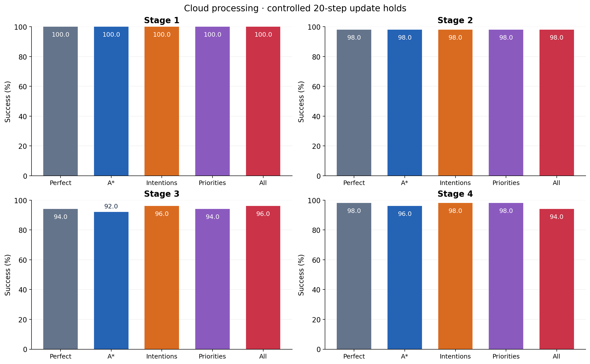
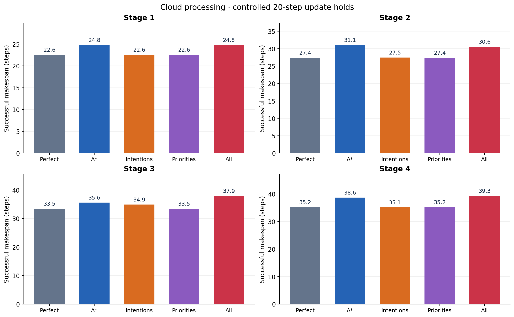
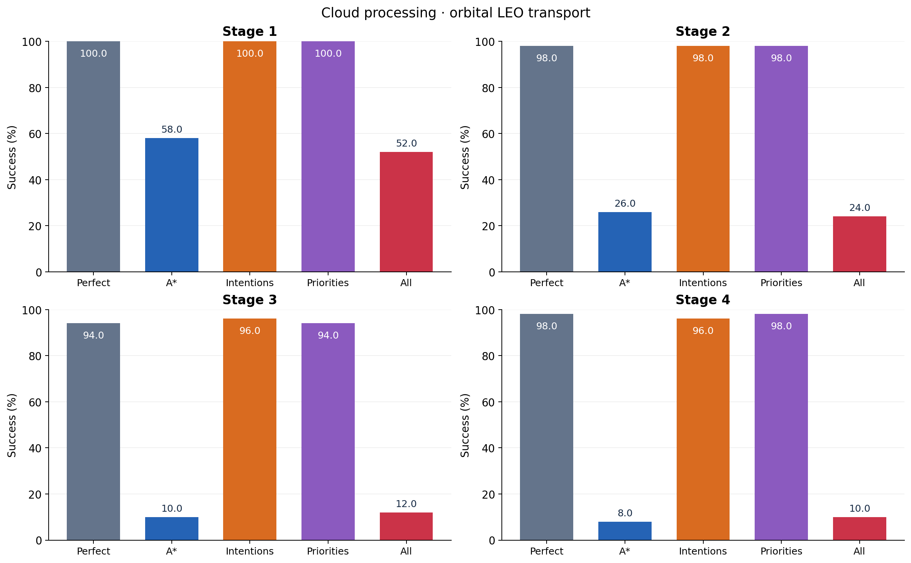
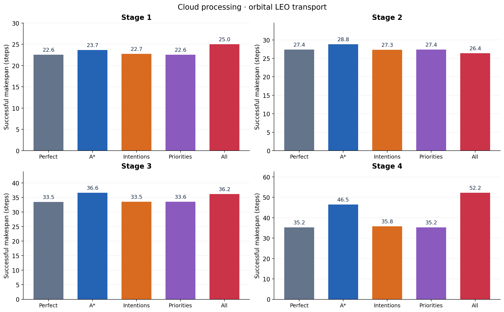

# Qualified-baseline mission-information inference

Run `leo-baseline-20261019-02` completed all **9,800 episodes in 49 conditions** in
19.31 minutes. Fifty held-out cases per stage use the
same seeds, starts and goals in every condition. One fully qualified Clean final
model is frozen throughout. No learning or model deployment occurs here.
Every episode has a 250-step cap and requires all goals to be occupied at once.

The audit recomputes success, successful makespan and PAR-2 from all measured
episode records, checks paired case identity, unselected input ages, policy and
frozen-code hashes, and checks four replay samples per condition. It passed.
The 33 preflight episodes are diagnostics and are outside the 9,800 study cases.

## Controlled update holds

The delay sweep is 1, 2, 5, 10 and 20 additional steps. Seeded service windows
hold selected updates, with newer updates waiting FIFO behind them. Between
holds and backlog, delivery is immediate: this profile bypasses physical link
transmission, propagation and framing, and both processing times are zero.
It is a controlled contention experiment, not a measured handover duration and
not a delay added to orbital transport. Cloud and UAV-edge outcomes are
identical in this controlled configuration.

Success at the 20-step setting:

| Condition | Stage 1 | Stage 2 | Stage 3 | Stage 4 |
| --- | ---: | ---: | ---: | ---: |
| Perfect communication | 100% | 98% | 94% | 98% |
| Delayed A* | 100% | 98% | 92% | 96% |
| Delayed intentions | 100% | 98% | 96% | 98% |
| Delayed priorities | 100% | 98% | 94% | 98% |
| All three delayed | 100% | 98% | 96% | 94% |

Mean successful makespan, in environment steps:

| Condition | Stage 1 | Stage 2 | Stage 3 | Stage 4 |
| --- | ---: | ---: | ---: | ---: |
| Perfect communication | 22.58 | 27.37 | 33.47 | 35.20 |
| Delayed A* | 24.78 | 31.08 | 35.59 | 38.62 |
| Delayed intentions | 22.58 | 27.47 | 34.90 | 35.08 |
| Delayed priorities | 22.58 | 27.37 | 33.47 | 35.20 |
| All three delayed | 24.82 | 30.55 | 37.94 | 39.26 |




See [success versus severity](controlled_cloud_success_rate.png),
[makespan versus severity](controlled_cloud_successful_makespan.png), and
[failure-aware PAR-2](controlled_cloud_par2.png) for the complete sweep.
Early completion can precede a scheduled reservation; no episode is extended to
manufacture exposure. With all three fields selected at 20 steps, realized
reservation exposure was 10/100, 57/200, 72/300 and 96/400 robot episodes across
Stages 1–4. These denominators count robots across the 50 cases at each stage.
Mean effects therefore include cases with no realized reservation exposure.

## Orbital transport, without artificial contention

This profile uses archived orbit geometry, shared transmission queues, framing,
handover and propagation, with artificial contention disabled.

| Condition | Stage 1 | Stage 2 | Stage 3 | Stage 4 |
| --- | ---: | ---: | ---: | ---: |
| Perfect communication | 100% | 98% | 94% | 98% |
| Delayed A* | 58% | 26% | 10% | 8% |
| Delayed intentions | 100% | 98% | 96% | 96% |
| Delayed priorities | 100% | 98% | 94% | 98% |
| All three delayed | 52% | 24% | 12% | 10% |

Mean successful makespan, in environment steps:

| Condition | Stage 1 | Stage 2 | Stage 3 | Stage 4 |
| --- | ---: | ---: | ---: | ---: |
| Perfect communication | 22.58 | 27.37 | 33.47 | 35.20 |
| Delayed A* | 23.66 | 28.85 | 36.60 | 46.50 |
| Delayed intentions | 22.74 | 27.35 | 33.50 | 35.75 |
| Delayed priorities | 22.58 | 27.41 | 33.55 | 35.20 |
| All three delayed | 25.04 | 26.42 | 36.17 | 52.20 |




The strong A* sensitivity appears on both routes. All paired route outcomes
are identical here, despite different subsecond delivery timings. Reports and
immediate action decisions occur at integer robot-step boundaries. Any positive
delivery time can leave previous-tick guidance at the decision, even with a
millisecond packet delay. The UAV-edge route already exhibits the effect, so
these results do **not** identify a satellite-handover-specific causal penalty.
In recorded case `agents-2-case-002`, delayed A* guidance accompanies a robot
oscillating between two cells while its partner reaches the goal. No local A*
reconnection or communication-triggered recovery controller is added.

## Reading makespan and uncertainty

Successful makespan excludes failures. A shorter successful-only average can
reflect different solved cases: orbital/all Stage 2 solves only 12/50 cases,
while Perfect solves 49/50. It is not a navigation improvement. Companion PAR-2
plots assign 500 steps to each failed 250-step episode and retain all cases.
The CSV also includes paired makespan differences on cases solved by both
conditions and paired bootstrap confidence intervals for success and PAR-2.
This is one trained seed and 50 paired cases per stage, not repeated training
seeds. Small success changes should be interpreted with those intervals.

Local obstacle and robot sensing, self-position, goals and physical collision
resolution stay fresh. Only the selected guidance, intention or priority caches
are delayed. No fabricated records, synthetic curve extensions or forced
success ordering are used.

## Files and editable plotting

- [All 18 figures](index.html), each in PNG, PDF and SVG, include both routes,
  the full controlled sweep, the 20-step overview and orbital comparisons.
- [Measured summary CSV](inference_summary.csv), [9,800 episode rows](paired_episode_results.csv),
  [audit](audit.json), [manifest](manifest.json), [held-out cases](held_out_cases.json).
- [Editable plotting script](plot_leo_inference.py), also in
  `scripts/plot_leo_inference.py` in the repository.
- [Protocol and timing assumptions](../../../docs/LEO_BASELINE_INFERENCE.md).

Rebuild locally from the frozen measured run:

```powershell
.venv/Scripts/python.exe scripts/plot_leo_inference.py --root output/inference/leo-baseline-20261019-02
```

Model, archived orbit, source snapshot and compressed per-episode replays remain
under the local run directory. Their hashes are retained here; large binary
assets and raw replays are not duplicated in Git. The earlier incomplete
`leo-baseline-20261019-01` is archived with numerical-stall diagnostics. This
replacement reran every case fresh after the fractional-bit service correction
in commit `054e5c0`; no partial-run outcome was carried forward.
